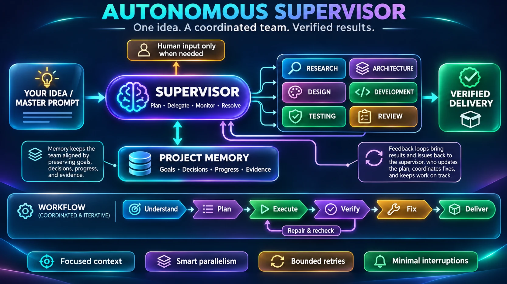

<div align="center">

# Autonomous Supervisor

**One idea. A coordinated team. Verified results.**

A reusable agent skill that turns an AI coding agent into an accountable senior team lead:
it plans from a brief, delegates to focused specialists, keeps **durable project memory**,
enforces **bounded retries and file ownership**, and only says *complete* when a
**verification gate** agrees.

[](https://github.com/toumo45/supervisor-skill/actions/workflows/ci.yml)


[](LICENSE)




</div>

---

## Why this exists

Strong models already *know* the principles of good supervision — verify claims, change strategy
after repeated failures, don't over-engineer a typo fix. We measured it (see [Benchmarks](#benchmarks)):
a baseline agent handled all 8 single-turn pressure scenarios correctly **without** any skill.

What they *don't* have is **state that outlives the conversation** and **rules that hold under drift**:

| Failure in real multi-session work | What the skill adds |
|---|---|
| Handoff notes live only in a chat reply the next session never sees | `.supervisor/state.json` + auto-rendered `MEMORY.md`, updated on every write |
| "Done" is whatever the agent last said | `gate` computes **VERIFIED COMPLETE / PARTIALLY COMPLETE / BLOCKED** from evidence |
| Fix #4 is a variation of fixes #1–3 | `task attempt` trips a **RETRY LIMIT** (exit 3) and forces a recorded strategy change |
| Two agents edit the same file | `task set … running` refuses overlapping file ownership, unmet deps, or exceeding the parallel limit |
| `verified` with no proof | `verify` / `verified` refuse to record without `--evidence` (exit 2) |
| "Verified" work edited later still counts as done | owned files are fingerprinted at verification; `resume` / `gate` flag drift for re-verification |
| Endless approach-switching | **STRATEGY LIMIT** after 3 approaches per task forces escalation |
| Work deferred to "later" is forgotten | `gate` refuses while next actions remain; criteria must span the whole scope |
| Ceremony on trivial tasks | Explicit **Direct / Lite / Full** mode selection up front |

## Install

**Claude Code plugin (recommended):**

```bash
/plugin marketplace add toumo45/supervisor-skill
```

```bash
/plugin install autonomous-supervisor@supervisor-skill
```

**Or copy the skill** into any skills directory (`~/.claude/skills/`, `.claude/skills/`, or `~/.agents/skills/`):

```bash
cp -r skills/autonomous-supervisor ~/.claude/skills/
```

Requirements: Python 3.8+ for the memory CLI (standard library only). Works without it via a manual memory fallback.

## Use

Give your agent a brief or master prompt:

> Build a CLI expense tracker with CSV import and a monthly report. Stdlib only.

The skill triggers on project-sized work (or say *"use the autonomous-supervisor skill"*). It will:

1. **Pick a mode** — Direct (just do it), Lite (criteria + gate), or Full (memory, delegation, gate).
2. **Define success** — brief with explicit assumptions, scope table, checkable acceptance criteria.
3. **Plan** — tasks with dependencies, owned files, and the criteria each one serves.
4. **Delegate** only where it wins, using a brief template with required slots (ownership, verification command, escalation conditions, report format).
5. **Verify** every report itself, recording the command and observed result as evidence.
6. **Recover** — bounded retries, strategy changes, and `resume` after interruptions.
7. **Deliver** — the gate's exact verdict, evidence per criterion, limitations, excluded scope.

### Audit an old or interrupted project ("is it really 100% done?")

Ask: *"I worked on this in earlier sessions — check everything I asked and tell me what's missing."*
The supervisor finds this project's past Claude Code sessions on its own (`~/.claude/projects/`), extracts
**every human prompt** (H1…Hn) and each session's final "done" claim, then verifies every requirement
against the code **as it is now**, so old claims and passing tests don't count as proof.

```bash
$SUP branches    # every branch vs the default: ahead/behind, merged?, and where the LATEST work is
$SUP sessions    # one line per past session: dates, prompt count, the original goal
$SUP harvest     # .supervisor/harvest.md: all prompts + final claims, secrets redacted, git-ignored
$SUP criterion add "missing file exits 3" --source H2   # requirement traced to the prompt it came from
$SUP criterion unverifiable AC5 --reason "needs the real server"   # neither passed nor failed
```

Three traps it handles, each found by auditing a real project with 20 branches and 22 cloud sessions:

- **The newest work isn't on the default branch.** A default checkout often shows one branch. `branches`
  warns, lists what the remote has, and `--fetch` brings it in. Work on an unmerged branch is reported as
  *built but unmerged*, not *missing*.
- **The sessions aren't on this machine.** Cloud or other-computer sessions are merged with
  `harvest --extra`; `events` copies typed prompts out of saved session dumps exactly. Sessions whose
  prompts were not read are listed in the coverage, with a count of how many ended waiting on the user.
- **Some things can't be checked here.** `unverifiable` keeps "not yet proven" apart from "failed".

The report (`templates/audit-report.md`) includes a traceability table, claims vs. reality, and a
mandatory **coverage** section listing the sessions read and the sources it *couldn't* see, such as
claude.ai chats or other machines. It never says "100% complete" while a source is uncovered.

### Big projects: mini-goals and questions for the owner (v1.4)

A large project is delivered as ordered **mini-goals**, each with its own criteria and its own gate, so
there is always one small, checkable target in front of the agent:

```bash
$SUP milestone add "Core parses CSV" && $SUP criterion add "pipes escaped" "empty input ok" --milestone M1
$SUP gate --milestone M1        # MILESTONE M1 VERIFIED - only the project gate decides "complete"
```

Questions only the owner can answer are recorded with a recommended default instead of living in chat.
Work continues on the default unless the question blocks a task; the answer becomes a binding decision:

```bash
$SUP ask "Postgres or SQLite?" --default "SQLite"                              # keep working on the default
$SUP ask "Spend on the paid API?" --default "no" --blocks T7 --because spend   # only T7 waits
$SUP answer Q2 "yes, up to \$5"                                 # recorded as a decision, T7 unblocked
```

**The supervisor decides; the owner is asked only for four things (v1.5).** Work may wait for a human only
for `spend`, `irreversible` actions, `access` the agent tried and failed to get, or a change of `goal`. The
CLI refuses to block a task for any other reason, and while anything can still move, `gate` and `resume` print
**NOT A STOPPING POINT**. "Complete" also means the whole roadmap: every mini-goal verified, every criterion
inside a mini-goal, every task serving a criterion. How the lead researches, debugs, rehearses and stays
efficient is in [`references/engineering.md`](skills/autonomous-supervisor/references/engineering.md).

Why: auditing a real five-week project showed 14 of its 22 sessions ended waiting on the owner, and the
same questions were asked again in later sessions because nothing had recorded them.

### The memory CLI at a glance

```bash
SUP="python3 skills/autonomous-supervisor/scripts/supervisor.py"
$SUP init --objective "CSV -> Markdown CLI" --max-parallel 3 --max-attempts 3
$SUP criterion add "Pipes escaped as \|"
$SUP task add "Core converter" --criteria AC1 --files "csvmd/core.py,tests/test_core.py"
$SUP task set T1 running --owner backend-agent      # guarded: deps, parallel limit, file overlap
$SUP task set T1 verified --evidence "unittest: Ran 21 tests OK"
$SUP criterion verify AC1 --evidence "echo 'c\na|b' | python3 -m csvmd -> 'a\|b'"
$SUP decide "Brief beats legacy test (newline -> <br>)" --why "spec is the contract"
$SUP resume     # after an interruption: do-not-redo / in-flight / ready / binding decisions
$SUP gate       # 0 VERIFIED COMPLETE | 10 PARTIALLY COMPLETE | 20 BLOCKED
$SUP harvest    # audit: every human prompt from past sessions -> .supervisor/harvest.md
```

## Repository layout

```
skills/autonomous-supervisor/
├── SKILL.md                    # the operating procedure (≈1.3k words, loads on trigger)
├── scripts/supervisor.py       # durable memory + guards + completion gate (stdlib)
├── templates/                  # project-brief, roadmap, task-assignment, verification-report, audit-report,
│                               # escalation, final-delivery, memory (manual fallback)
└── references/                 # delegation rules, recovery procedures, host adaptation, audit mode
tests/
├── test_supervisor_cli.py      # 110 behavioural tests of the CLI (incl. concurrency, harvest, branches)
├── validate_skill.py           # structural lint (frontmatter, links, word budget)
├── scenarios/                  # 8 pressure scenarios + recorded results
└── e2e/                        # benchmark briefs, seeded starter, hidden acceptance oracles,
                                #   reference implementations (csvmd, parallel/textkit)
evals/                          # `claude plugin eval` suite: 4 outcome + 7 trigger cases,
                                #   with-plugin vs no-plugin arms
.claude-plugin/                 # plugin + marketplace manifests
```

## Benchmarks

Every number below comes from a real run in this repo's harness: same model, fresh context,
identical prompts except *"read SKILL.md and follow it"*. Hidden acceptance tests were never
shown to the agents. Details and transcripts summary: [`tests/scenarios/results.md`](tests/scenarios/results.md).

| Test | Baseline (no skill) | With skill |
|---|---|---|
| 8 single-turn pressure scenarios | 8/8 correct | No regressions (Direct mode on trivial tasks, honest fallbacks) |
| E2E build, one session | 18/18 · 94k tokens · 5 calls | 18/18 · 100k tokens · 8 calls · chose **Lite** mode |
| Interruption, fully specified brief | 18/18 · no durable handoff | 18/18 · full `.supervisor/` memory |
| Full mode: 3 parallel workers vs one agent (`textkit`) | 21/21 · 14 tests · 92k tokens · 28s | 21/21 · **35 tests** · ~3x tokens · 71s · zero file conflicts |
| **Audit where the work sits on an unfetched branch** (2 runs each) | skill v1.2: **0/2**, reported built features as "missing" | skill v1.3: **2/2**, "built but unmerged", sync marked unverifiable |
| **Audit this repo against its real 5.8 MB session history** (location not given) | Correct verdict · 139k tokens · 20 tool calls · partly quoted the old session's own notes | Correct verdict · **116k tokens · 13 tool calls** · verified each gap directly · coverage stated |
| **Interruption + user clarifications given mid-session** | **18/20**: session 2 *deleted* a user-requested feature as "scope creep" and dropped the exit-code override | **20/20**: both honoured via a binding decision, deviation from the brief disclosed |

**Honest reading:** on small, fully specified, single-session work a strong model doesn't need
this skill, and the skill costs about 6% more tokens. It pays off where real projects fail.
Requirements that live in conversation, work that crosses sessions or context resets, and
"done" claims that need to be audited. The benchmark also **caught a bug in the skill itself**:
the gate passed on criteria that covered only one session's slice. The bug is fixed and covered
by regression tests. Dogfooding Full mode caught a second one: the parallel limit counted
the supervisor's own integration task. Fixed and regression-tested. The parallel run also showed
that fanning out to subagents for small tracks costs about 3x the tokens without improving the
score, so the skill now fans out only for substantial tracks.

### `claude plugin eval`: with vs. without the plugin

[`evals/`](evals/) holds 11 cases. Each runs in a with-plugin arm and a no-plugin baseline arm on
Sonnet 5.5, and anyone can reproduce them with one command.

| Finding | Before | After |
|---|---|---|
| **Discovery:** did the skill fire on its own? | **0/6.** Earlier benchmarks *told* agents to read SKILL.md, so discovery was never tested | Description rewritten using a trigger micro-eval: **0.57 → 1.00** (fires on 8/8 project prompts, stays quiet on typo and question prompts) |
| Brief + handoff prompt | 0/4 | **6/6** |
| "Continue the interrupted project" | 1/4 | **8/9.** `MEMORY.md` now describes itself (names the skill and the exact `resume` command) |
| Sandboxed or read-only shell | Raw `OSError`; progress unrecorded (0/2) | CLI exits `4` with a fallback; progress kept in `MANUAL.md` (**3/3**) |
| `gate-honesty` ("workers say done") | baseline 0.75 | **1.00** with the skill (Δ +0.25) |

The single-session outcome cases otherwise tie at 1.00 in both arms. Sonnet 5.5 handles them
alone, so they serve as regression guards. Note: in this repo's cloud container, the eval
sandbox mounted the workspace read-only for shell commands, which disabled the CLI in eval runs.
The outcome evidence that shows the skill's value is therefore the subagent benchmarks above,
where the shell could write.

## Development

```bash
python3 tests/validate_skill.py                    # skill structure lint
python3 -m unittest discover -s tests -v           # CLI behaviour tests
python3 -I tests/e2e/hidden_acceptance.py tests/e2e/reference   # oracle self-check: 18/18
python3 -I tests/e2e/parallel/hidden_acceptance.py tests/e2e/parallel/reference   # 21/21
claude plugin validate .                           # manifests, skill, icon
claude plugin eval . --scaffold --trust-plugin --allow-tools Bash Write Edit -j 4   # with vs without plugin
```

The skill was built test-first following the *writing-skills* method: pressure scenarios were run
**without** the skill to record baseline behaviour, guidance was written only for observed gaps,
and the same scenarios were re-run **with** the skill. Full transcripts are summarised in
[`tests/scenarios/results.md`](tests/scenarios/results.md).

## Design references

Evaluated as inspiration, not copied: [obra/superpowers](https://github.com/obra/superpowers)
(evidence-based verification, subagent execution), [ehnruiz/claude-skills](https://github.com/ehnruiz/claude-skills)
(supervisor workflow), [ruvnet/ruflo](https://github.com/ruvnet/ruflo) (shared memory orchestration),
[troykelly/claude-skills](https://github.com/troykelly/claude-skills) (issue-driven autonomy),
[OpenHands/software-agent-sdk](https://github.com/OpenHands/software-agent-sdk) (agent runtime),
[crewAIInc/crewAI](https://github.com/crewAIInc/crewAI) (role-based teams).

## License

[MIT](LICENSE) © 2026 Kamari Fatima Zuhra

## Guiding principle

**One clear objective. One accountable supervisor. Focused specialists. Shared memory.
Measurable progress. Verified completion. Minimal unnecessary human intervention.**
